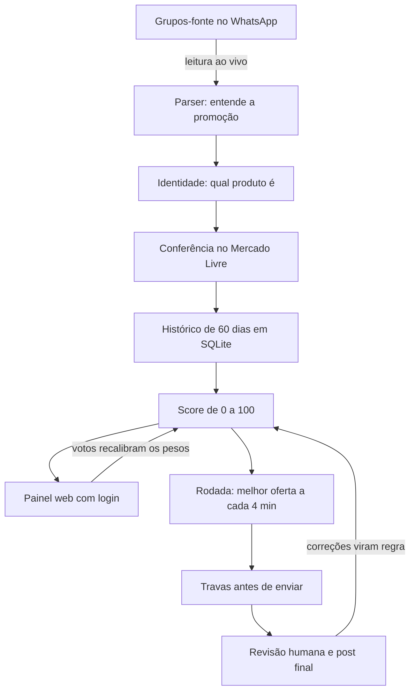

# Curadora de Ofertas

Sistema que lê promoções de perfume em grupos de WhatsApp, confere cada uma no Mercado Livre e dá uma nota de 0 a 100
dizendo se a oferta é boa de verdade. A equipe usa um painel web para ver as melhores ofertas e decidir o que postar.

Construí este projeto com Claude Code a partir de outubro de 2026 e ele roda em produção numa VPS Linux.

Este repositório tem o pipeline inteiro, em duas gerações:

- **Curadora** (raiz do repositório): a versão atual, descrita abaixo.
- **Coletora e normalizadora** (`coletora-normalizadora/`): a primeira versão, que rodava a cada minuto nas janelas de
  venda. A coletora lê os grupos, confere no Mercado Livre e escolhe as ofertas; a normalizadora transforma a oferta
  bruta em post pronto (chamada, título, preço, cupom e imagem) para revisão humana.

> **Sobre esta cópia.** Este repositório é uma versão de portfólio. IDs de grupos, links de afiliado, nomes de grupos
> e de pessoas e o endereço do servidor foram trocados por valores fictícios. O banco de dados real não está aqui.

## O problema

Eu trabalho com uma equipe que posta promoções de perfume num grupo público. As promoções vêm de cerca de 9 grupos-fonte,
que postam centenas de ofertas por dia, e muitas são ruins:

- preço "de sempre" com cara de promoção;
- vendedor duvidoso (há muita falsificação de perfume);
- cupom que já acabou ou que não vale naquele anúncio;
- link que cai em outro produto: outro volume, outra versão.

Antes, a escolha era feita no olho.

## O que a curadora faz

1. Lê tudo o que chega nos grupos-fonte, ao vivo (só leitura).
2. Confere cada promoção no Mercado Livre na hora: preço de agora, quem vende, selo de loja oficial e se o link é
   mesmo daquele produto.
3. Compara o preço com a mediana dos últimos 60 dias daquele produto exato e dá a nota: Excelente, Boa, Média ou Ruim,
   com o motivo.
4. Mostra tudo num painel com login para a equipe filtrar, encaminhar e votar. Os votos recalibram os pesos da nota.
5. Na rodada da noite, escolhe a melhor oferta a cada 4 minutos e manda para virar post. O post final é sempre
   revisado e publicado por uma pessoa.
6. Aprende com as correções: cada cupom tirado ou chamada trocada na revisão volta como regra.



## Resultados medidos

- Na semana de 13 a 19/10/2026, 69% dos posts que vieram da curadora eram ofertas Boas ou Excelentes, contra 22% dos
  posts escolhidos à mão pela equipe.
- Numa rodada de sexta (30/10/2026, das 16h35 às 21h26), o pipeline mandou 95 ofertas: 23 Excelentes, 48 Boas e
  21 Médias.

## Como garanto que funciona

- **887 testes automatizados**, que rodam em cerca de 15 segundos e sem internet.
- Os testes usam mensagens e páginas reais salvas em `tests/fixtures/`, conferidas campo a campo.
- Propriedades do score que precisam valer sempre: um preço mais barato nunca piora a nota, um preço acima do normal
  nunca é "boa", e a nota nunca usa dados do futuro.
- Cada erro encontrado em dado real vira um teste.
- Travas antes de enviar: vendedor com poucas vendas, cupom esgotado e link que aponta para outro produto são barrados.
- Em produção: backup diário, um vigilante que avisa no WhatsApp quando algo para, e uma revisão automática ao fim
  de cada rodada comparando o que foi enviado, postado e corrigido.

## Como rodar

Só usa a biblioteca padrão do Python (3.10 ou mais novo). Não há dependências para instalar.

```bash
python -X utf8 -m unittest discover -s tests
```

Os scripts de `coletora-normalizadora/` foram feitos para rodar no servidor Linux: parte dos testes de lá depende de
módulos e caminhos do servidor e não passa no Windows (78 de 103 passam).

O painel e a leitura ao vivo dependem de uma ponte de WhatsApp e de credenciais do Mercado Livre que não fazem parte
deste repositório.

## Mapa do código

| Caminho | Papel |
|---|---|
| `painel.py`, `painel/` | servidor do painel e as rotinas que rodam junto (ao vivo, vigia de preço, radar) |
| `pipeline.py` | a rodada: escolhe, confere e envia a oferta |
| `curadora/parser.py` | lê a promoção de qualquer grupo |
| `curadora/identidade.py` | descobre qual produto é |
| `curadora/ml.py`, `curadora/ml_api.py` | conferência na página e na API pública do Mercado Livre |
| `curadora/historico.py` | preço normal dos últimos 60 dias |
| `curadora/score.py` | a nota de 0 a 100 |
| `curadora/travas.py` | as travas antes de enviar |
| `curadora/cupons.py`, `curadora/esgotados.py` | leitura e estado dos cupons |
| `curadora/conferente.py` | segunda leitura e aprendizado com as correções |
| `curadora/acesso.py`, `usuarios.py` | login, convites e sessões do painel |
| `curadora/calibracao.py` | ajuste dos pesos pelos votos |
| `curadora/banco.py` | esquema do SQLite |
| `manutencao.py` | backup e vigilante |
| `vps/` | serviços e timers do systemd, Caddyfile |
| `coletora-normalizadora/perfume_deliver.py` | a coletora (primeira versão) |
| `coletora-normalizadora/perfume_manual_normalizer.py` | a normalizadora: monta o post a partir da oferta bruta |
| `coletora-normalizadora/window_perfume_*.sh` | ligam e desligam a coletora nas janelas de venda |
| `tests/` | a suíte de testes |

## Tecnologias

Python (biblioteca padrão), SQLite, HTML/CSS/JS sem framework, systemd, Caddy, API do Mercado Livre, WhatsApp.
Desenvolvido com Claude Code.
